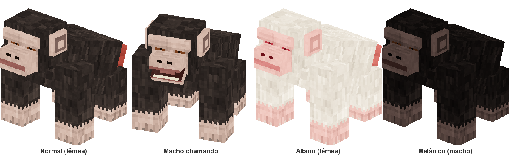

# Minecraft Mobs

Mod de mobs para Minecraft feito com **Fabric**. Atualmente adiciona o **Elefante**, das savanas, e o **Chimpanzé**, das selvas.

| | |
|---|---|
| Minecraft | 26.3 |
| Fabric Loader | ≥ 0.19.5 |
| Fabric API | 0.161.0+26.3 |
| Java | 25 |
| Versão do mod | 0.1.0 |
| Mod ID | `mobmod` |

## Conteúdo

### Elefante (`mobmod:elephant`)

- **Tamanho:** cerca de 3 blocos de altura, com proporções de um elefante africano. Machos são 15% maiores e têm presas mais longas.
- **Comportamento:** neutro. Vive em manadas e só ataca se for ferido ou se um filhote da manada for ferido. Filhotes não lutam: fogem em pânico e chamam os adultos.
- **Atributos:** 60 de vida, 8 de dano, resistência alta a knockback e sobe blocos de altura 1.
- **Spawn:** biomas de savana, em grupos de 2 a 4.
- **Reprodução:** alimentado com os itens da tag `mobmod:elephant_food`, que também o atraem. Só um macho e uma fêmea geram filhotes.
- **Extras:** ovo de spawn na aba criativa (Spawn Eggs), loot table própria e traduções em inglês e português (BR).

### Chimpanzé (`mobmod:chimpanzee`)

- **Tamanho:** real, cerca de 1 bloco de altura andando de quatro apoiado nos nós dos dedos. Machos são 15% maiores; fêmeas adultas têm o inchaço vermelho na traseira.
- **Comportamento:** neutro. Vive em bandos de 3 a 6, escala paredes e árvores como uma aranha sem cair sem querer da copa, e o bando defende quem for atacado.
- **Animações:** caminhada com balanço do corpo, respiração, cabeça curiosa, orelhas que mexem, boca que abre ao chamar e escalada com braços e pernas.
- **Atributos:** 24 de vida, 4 de dano, velocidade 0.3.
- **Spawn:** biomas de selva.
- **Reprodução:** maçã, fatia de melancia, bagas doces, bagas brilhantes e sementes de cacau. Só um macho e uma fêmea geram filhotes.
- **Árvores:** sobe com frequência nas árvores, atravessando a folhagem pelo tronco, fica de 30 a 90 s na copa e depois desce sem se machucar.
- **Fezes:** chance baixa de jogar fezes num jogador próximo (em média uma vez por minuto). Funcionam como a bola de neve (empurram, sem dano) e o jogador também pode arremessá-las. Os adultos deixam fezes no chão a cada 5 a 10 minutos, como a galinha bota ovos.
- **Drops:** nenhum item.

Fichas completas: [Elefante](docs/mobs/elefante.md) e [Chimpanzé](docs/mobs/chimpanze.md).

### Para todos os mobs

- **Sexo:** macho ou fêmea, com reprodução igual à vanilla, mas só entre sexos opostos.
- **Variantes de pele:** albino e melânico (1% cada), herdadas dos pais.
- **Barra de informações:** nome, sexo (♂/♀) e vida acima do mob, no estilo Mo'Creatures.
- **Regeneração:** fora de combate, a vida volta sozinha (cheia em 2 minutos, começando 10 s depois do último dano). Dar a comida a um mob ferido cura 10% da vida.




Detalhes em [genetica.md](docs/projeto/genetica.md). Cada mob tem sua ficha completa em [docs/mobs](docs/mobs/README.md).

## Como usar

1. Instale o [Fabric Loader](https://fabricmc.net/use/) para o Minecraft 26.3.
2. Coloque o [Fabric API](https://modrinth.com/mod/fabric-api) na pasta `mods`.
3. Coloque o `mobmod-0.1.0.jar` na pasta `mods`.

## Desenvolvimento

Requer **JDK 25**. Tudo roda pelo Gradle Wrapper; a primeira execução baixa o Gradle, o Minecraft e as dependências.

```bash
./gradlew build               # compila e gera build/libs/mobmod-0.1.0.jar
./gradlew runDatagen          # regenera lang, loot tables, tags e modelos em src/main/generated
./gradlew runClient           # abre o Minecraft com o mod (pasta run/)
./gradlew runServer           # servidor de desenvolvimento
./gradlew runGameTestServer   # sobe um servidor, roda os gametests e sai
```

As versões do Minecraft, Loader e Fabric API ficam em [`gradle.properties`](gradle.properties).

## Estrutura

Cada mob vive no próprio pacote e é declarado uma vez numa `MobDefinition`. Registro, spawn, ovo, traduções, loot, tags e testes saem dessa definição.

```
src/main/java/.../core/          MobDefinition, SpawnRule e ModMobs (lista de todos os mobs)
src/main/java/.../mob/<nome>/    entidade e definição de cada mob
src/client/java/.../core/        ClientMob e ModMobsClient (lado cliente de todos os mobs)
src/client/java/.../mob/<nome>/  modelo, renderer e registro cliente de cada mob
src/client/java/.../datagen/     providers do datagen
src/main/generated/              JSONs gerados pelo datagen (não editar à mão)
docs/                            documentação do projeto
```

Adicionar um mob é criar as duas pastas dele, colocar uma linha em `ModMobs` e outra em `ModMobsClient`, e rodar `runDatagen`. O passo a passo está em [como adicionar um mob](docs/projeto/como-adicionar-um-mob.md).

## Documentação

- [Índice da documentação](docs/README.md)
- [Visão geral do projeto](docs/projeto/visao-geral.md)
- [Como adicionar um mob](docs/projeto/como-adicionar-um-mob.md)
- [Genética: sexo, reprodução e variantes](docs/projeto/genetica.md)
- [Regeneração de vida](docs/projeto/regeneracao.md)
- [Fichas dos mobs](docs/mobs/README.md)
- [Análise dos mobs do Promenade](docs/analises/analise-mobs-promenade.md) (referência usada na criação do mod)

## Licença

All Rights Reserved. Autor: Otavi.
