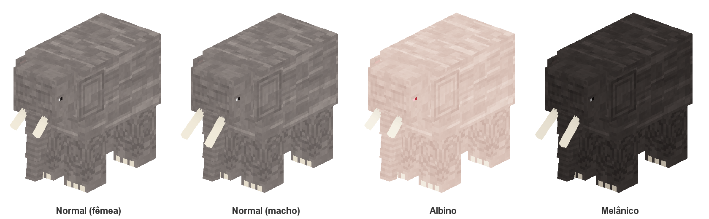

# Elefante

| | |
|---|---|
| ID | `mobmod:elephant` |
| Nome | Elephant / Elefante |
| Inspiração | Elefante-africano-da-savana |
| Categoria | `CREATURE` (animal passivo, conta no limite de animais) |
| Classe base | `ModAnimal` → `Animal` |
| Temperamento | Neutro |
| Adicionado em | 0.1.0 |



Um animal neutro das savanas. Vive em manadas, só luta quando ele ou um filhote da manada é ferido, e é o maior animal do mod.

## Arquivos

| O quê | Onde |
|---|---|
| Definição (tamanho, spawn, comida, loot, nome) | [`mob/elephant/ElephantMob.java`](../../src/main/java/com/otavi/mobmod/mob/elephant/ElephantMob.java) |
| Entidade (atributos, IA, ataque, sons) | [`mob/elephant/Elephant.java`](../../src/main/java/com/otavi/mobmod/mob/elephant/Elephant.java) |
| Modelo e animações | [`client/mob/elephant/ElephantModel.java`](../../src/client/java/com/otavi/mobmod/client/mob/elephant/ElephantModel.java) |
| Renderer e render state | [`ElephantRenderer.java`](../../src/client/java/com/otavi/mobmod/client/mob/elephant/ElephantRenderer.java), [`ElephantRenderState.java`](../../src/client/java/com/otavi/mobmod/client/mob/elephant/ElephantRenderState.java) |
| Registro cliente (camadas e renderer) | [`ElephantClient.java`](../../src/client/java/com/otavi/mobmod/client/mob/elephant/ElephantClient.java) |
| Texturas | `src/client/resources/assets/mobmod/textures/entity/elephant/` |
| Gerador das texturas | [`tools/textures/ElephantTexture.java`](../../tools/textures/ElephantTexture.java) |
| JSON gerados (lang, loot, tag, modelo do ovo) | `src/main/generated/` (via `./gradlew runDatagen`) |

## Atributos

| Atributo | Valor | Observação |
|---|---|---|
| Vida máxima | 60 | 30 corações (vaca: 10) |
| Velocidade de movimento | 0.2 | Mesma base da vaca. Os goals multiplicam esse valor (veja IA) |
| Dano de ataque | 8 | 4 corações por golpe, antes da armadura |
| Knockback do ataque | 2.0 | Arremessa o alvo para longe |
| Resistência a knockback | 0.8 | Ignora 80% do knockback recebido |
| Altura de passo | 1.0 | Sobe um bloco inteiro sem pular |
| Escala | 1.0 fêmea / 1.15 macho | Bônus de macho aplicado por `ModAnimal` (`minecraft:scale`) |

Os demais atributos vêm de `Animal.createAnimalAttributes()`, com os valores padrão do jogo.

## Tamanho e hitbox

| | Largura × altura (blocos) | Altura dos olhos |
|---|---|---|
| Fêmea adulta | 2.6 × 3.0 | 2.6 |
| Macho adulto | 2.99 × 3.45 | 2.99 |
| Filhote fêmea | 1.3 × 1.5 | 1.3 |
| Filhote macho | 1.5 × 1.73 | 1.5 |

O filhote usa a escala de idade vanilla (0.5), que multiplica a escala de sexo. A distância de rastreamento do cliente é de 10 chunks (`clientTrackingRange(10)`), para que um animal desse tamanho não suma de perto.

## Comportamento e IA

### Goals (por prioridade, menor = mais importante)

| Prioridade | Goal | Detalhes |
|---|---|---|
| 0 | `FloatGoal` | Nada para não afundar |
| 1 | `AdultMeleeAttackGoal` | Só adultos. Persegue o alvo a 1.25× a velocidade e continua mesmo sem vê-lo |
| 1 | `BabyPanicGoal` | Só filhotes. Ao levar dano, foge a 1.6× a velocidade |
| 2 | `BreedGoal` | Procura parceiro quando está em love mode (velocidade 1.0×) |
| 3 | `TemptGoal` | Segue o jogador segurando comida da tag `mobmod:elephant_food` (1.1×). Não se assusta com movimentos bruscos |
| 4 | `FollowParentGoal` | Filhotes seguem um adulto (1.1×) |
| 5 | `WaterAvoidingRandomStrollGoal` | Passeia evitando a água (1.0×) |
| 6 | `LookAtPlayerGoal` | Olha para jogadores a até 8 blocos |
| 7 | `RandomLookAroundGoal` | Olha ao redor quando está parado |

### Alvos

| Prioridade | Goal | Detalhes |
|---|---|---|
| 1 | `HurtByTargetGoal` + `setAlertOthers()` | Quem ataca um elefante vira alvo dele **e dos elefantes próximos** |

Resultado:
- Atacar um adulto faz a manada inteira contra-atacar.
- Atacar um filhote faz o filhote fugir e os adultos próximos atacarem.
- Sem provocação, o elefante nunca ataca.

### Ataque

- Corpo a corpo com 8 de dano e knockback 2.
- A cada golpe toca o som de ataque do Ravager e dispara a animação de ataque, que dura 10 ticks (0,5 s) e é sincronizada com o cliente pelo evento de entidade `4`.

## Reprodução

Usa o sistema global de [genética](../projeto/genetica.md):

| | |
|---|---|
| Comida (tag `mobmod:elephant_food`) | Trigo, maçã e fardo de feno |
| Quem pode acasalar | Somente macho + fêmea |
| Love mode, cooldown e XP | Iguais aos animais vanilla |
| Filhote | Sexo 50/50 e variante herdada de um dos pais (1% de mutação para cada variante rara) |
| Crescimento | Igual aos animais vanilla. A comida acelera o crescimento do filhote |

A mesma comida atrai o elefante (`TemptGoal`) e é usada em `isFood`.

## Regeneração

Usa o sistema global de [regeneração](../projeto/regeneracao.md):

| | |
|---|---|
| Por tempo | 0,5 por segundo, vida cheia em 2 min |
| Começa | 10 s depois do último dano, e só fora de combate (sem alvo) |
| Comida | Cada item da comida cura 6 de vida (3 corações), sem entrar em love mode (com a vida cheia, serve para reproduzir) |

## Sexo e variantes

| | Fêmea | Macho |
|---|---|---|
| Tamanho | 100% | 115% (hitbox e modelo) |
| Presas | Curtas (9 px) | Longas (13 px) |
| Símbolo na barra | ♀ rosa | ♂ azul |

| Variante | Chance no spawn | Textura | Visual |
|---|---|---|---|
| Normal | 98% | `elephant.png` | Cinza com estrias claras |
| Albino | 1% | `elephant_albino.png` | Pele creme-rosada, olho vermelho |
| Melânico | 1% | `elephant_melanistic.png` | Quase preto, estrias discretas |

Sexo e variante são salvos no NBT (`Sex`, `SkinVariant`) e aparecem na barra de informações acima do elefante (nome, variante rara, sexo e vida), a até 16 blocos.

## Spawn natural

| | |
|---|---|
| Biomas | Tag `#minecraft:is_savanna` (savana, planalto de savana, savana fustigada pelo vento e biomas de outros mods que usem a tag) |
| Peso | 5 |
| Tamanho do grupo | 2 a 4 |
| Posicionamento | No chão (`ON_GROUND`), heightmap `MOTION_BLOCKING_NO_LEAVES` |
| Regras | `Animal.checkAnimalSpawnRules`: precisa de bloco de grama embaixo e luz suficiente, como os animais vanilla |

## Drops

| Item | Quantidade | Pilhagem (Looting) |
|---|---|---|
| Couro | 1 a 3 | +0 a 1 por nível |

Tabela gerada: `data/mobmod/loot_table/entities/elephant.json`, com `random_sequence` `mobmod:entities/elephant`. Também solta a XP padrão de animal ao ser morto por um jogador.

## Sons

Todos emprestados do Ravager, com o tom da voz em **0.8×** (mais grave):

| Evento | Som | Detalhe |
|---|---|---|
| Ambiente | `entity.ravager.ambient` | A cada 240 ticks (12 s) em média |
| Dano | `entity.ravager.hurt` | |
| Morte | `entity.ravager.death` | |
| Passos | `entity.ravager.step` | Volume 0.3, tom 0.8 |
| Ataque | `entity.ravager.attack` | Só quando o golpe acerta |

## Modelo

Feito em código Java, sem Blockbench nem GeckoLib. Textura de 256×256. Medidas em pixels do modelo (16 px = 1 bloco), para a fêmea adulta:

| Parte | Tamanho (L × A × C) | Observação |
|---|---|---|
| Corpo | 26 × 26 × 40 | Caixa alta, do chão +20 px até 46 px |
| Pernas (4) | 10 × 22 × 10 | Pernas-coluna, quase metade da altura |
| Cabeça | 18 × 16 × 12 | Na frente do corpo, topo logo abaixo dos ombros |
| Tromba | 6×10×6 → 5×9×5 → 4×8×4 | Três segmentos, quase até o chão |
| Presas curtas (fêmea) | 2 × 9 × 2 | Para frente e para baixo |
| Presas longas (macho) | 2 × 13 × 2 | Mesma posição; o modelo mostra uma ou outra pelo sexo |
| Orelhas (2) | 1 × 15 × 13 | Painéis planos atrás dos olhos, rentes à lateral do corpo |
| Cauda | 2 × 14 × 2 | Com tufo escuro na ponta |

O filhote é o mesmo modelo reduzido à metade (`MeshTransformer.scaling(0.5F)`).

O layout UV de cada peça está documentado no topo de `tools/textures/ElephantTexture.java`.

## Animações

Todas procedurais, calculadas em `ElephantModel.setupAnim`:

| Animação | Como funciona |
|---|---|
| Cabeça | Acompanha o olhar: metade da inclinação vertical e até 40° para os lados |
| Caminhada | Pernas diagonais juntas, passada lenta e curta (amplitude 0.7) |
| Tromba | Balança devagar nos três segmentos, em ondas, e acompanha o passo |
| Orelhas | Abanam para fora periodicamente, sem atravessar o corpo |
| Cauda | Balança de um lado para o outro |
| Ataque | Levanta a cabeça e enrola a tromba para cima, depois desce (0,5 s) |

## Itens e creative

| | |
|---|---|
| Ovo gerador | `mobmod:elephant_spawn_egg` ("Elephant Spawn Egg" / "Ovo Gerador de Elefante") |
| Aba criativa | Spawn Eggs, logo depois do ovo de Elder Guardian |
| Textura do ovo | `textures/item/elephant_spawn_egg.png`: o rosto do elefante de frente, desenhado à mão, com fundo transparente |

## Traduções

| Chave | en_us | pt_br |
|---|---|---|
| `entity.mobmod.elephant` | Elephant | Elefante |
| `item.mobmod.elephant_spawn_egg` | Elephant Spawn Egg | Ovo Gerador de Elefante |
| `tag.item.mobmod.elephant_food` | Food for Elephants | Comida para Elefantes |

## Comandos úteis

```
/summon mobmod:elephant
/summon mobmod:elephant ~ ~ ~ {Sex:"male",SkinVariant:"albino"}
/summon mobmod:elephant ~ ~ ~ {Age:-24000}
/data get entity @e[type=mobmod:elephant,limit=1,sort=nearest]
```

`Age:-24000` cria um filhote. Ainda não foi verificado no jogo se o `/summon` com NBT mantém `Sex`/`SkinVariant` ou se o spawn sorteia de novo. Se sortear, use `/data merge entity` depois de invocar.

## Testes automáticos

Coberto pelos gametests genéricos (`./gradlew runGameTestServer`), que percorrem todos os mobs:
- nasce e sobrevive;
- tem loot table;
- macho maior que fêmea;
- só macho + fêmea acasalam;
- dois pais albinos nunca têm filhote normal.
