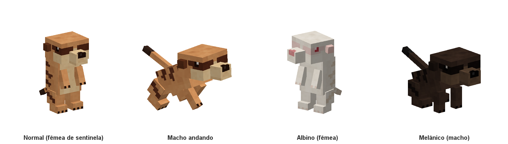

# Suricato

| | |
|---|---|
| ID | `mobmod:meerkat` |
| Nome | Meerkat / Suricato |
| Inspiração | Suricato (*Suricata suricatta*), do deserto do Kalahari |
| Categoria | `CREATURE` (animal passivo, conta no limite de animais) |
| Classe base | `ModAnimal` → `Animal` |
| Temperamento | Neutro |
| Adicionado em | 0.1.0 |



Um pequeno animal neutro dos desertos. Vive em grupos, anda de quatro e, de vez em quando, para e fica em pé nas patas de trás para vigiar (a pose de sentinela das referências), olhando ao redor ou encarando o jogador que estiver por perto. Quando vê perigo, dá um grito de alarme e o grupo inteiro entra na terra para se esconder, e à noite dorme embaixo da terra. Os adultos caçam os "insetos" do jogo (traças e endermites), e o grupo inteiro ataca quem machucar um deles.

## Arquivos

| O quê | Onde |
|---|---|
| Definição (tamanho, spawn, comida, nome) | [`mob/meerkat/MeerkatMob.java`](../../src/main/java/com/otavi/mobmod/mob/meerkat/MeerkatMob.java) |
| Entidade (atributos, IA, postura, toca, ataque, sons, regra de spawn) | [`mob/meerkat/Meerkat.java`](../../src/main/java/com/otavi/mobmod/mob/meerkat/Meerkat.java) |
| Toca (entrar na terra) | [`MeerkatBurrowGoal.java`](../../src/main/java/com/otavi/mobmod/mob/meerkat/MeerkatBurrowGoal.java) |
| Sentinela | [`MeerkatSentinelGoal.java`](../../src/main/java/com/otavi/mobmod/mob/meerkat/MeerkatSentinelGoal.java) |
| Modelo e animações | [`client/mob/meerkat/MeerkatModel.java`](../../src/client/java/com/otavi/mobmod/client/mob/meerkat/MeerkatModel.java) |
| Renderer e render state | [`MeerkatRenderer.java`](../../src/client/java/com/otavi/mobmod/client/mob/meerkat/MeerkatRenderer.java), [`MeerkatRenderState.java`](../../src/client/java/com/otavi/mobmod/client/mob/meerkat/MeerkatRenderState.java) |
| Registro cliente | [`MeerkatClient.java`](../../src/client/java/com/otavi/mobmod/client/mob/meerkat/MeerkatClient.java) |
| Texturas | `src/client/resources/assets/mobmod/textures/entity/meerkat/` |
| Gerador das texturas e do ovo | [`tools/textures/MeerkatTexture.java`](../../tools/textures/MeerkatTexture.java) |
| JSON gerados (lang, tag, modelo do ovo) | `src/main/generated/` (via `./gradlew runDatagen`) |

## Atributos

| Atributo | Valor | Observação |
|---|---|---|
| Vida máxima | 10 | 5 corações, igual à raposa |
| Velocidade de movimento | 0.3 | Igual à raposa e ao chimpanzé |
| Dano de ataque | 2 | 1 coração por mordida, antes da armadura |
| Escala | 1.0 fêmea / 1.15 macho | Bônus de macho aplicado por `ModAnimal` (`minecraft:scale`) |

Os demais atributos vêm de `Animal.createAnimalAttributes()`, com os valores padrão do jogo.

## Tamanho e hitbox

| | Largura × altura (blocos) | Altura dos olhos |
|---|---|---|
| Fêmea adulta | 0.4 × 0.6 | 0.5 |
| Macho adulto | 0.46 × 0.69 | 0.58 |
| Filhote fêmea | 0.2 × 0.3 | 0.25 |
| Filhote macho | 0.23 × 0.35 | 0.29 |

Em pé, o suricato tem cerca de 0,6 bloco, como nas imagens de referência. É o dobro de um suricato real (30 a 35 cm em pé), para ele continuar visível no jogo. A hitbox é a mesma em pé e de quatro. A distância de rastreamento do cliente é de 8 chunks.

## Comportamento e IA

### Goals (por prioridade, menor = mais importante)

| Prioridade | Goal | Detalhes |
|---|---|---|
| 0 | `FloatGoal` | Nada para não afundar |
| 1 | `MeerkatBurrowGoal` | Entra na terra para se esconder de ameaças, dormir à noite ou descansar (veja abaixo) |
| 1 | `AdultMeleeAttackGoal` | Só adultos. Persegue o alvo a 1.4× a velocidade e continua mesmo sem vê-lo |
| 1 | `BabyPanicGoal` | Só filhotes. Ao levar dano, foge a 1.8× a velocidade |
| 2 | `BreedGoal` | Procura parceiro quando está em love mode (1.0×) |
| 3 | `TemptGoal` | Segue o jogador segurando comida da tag `mobmod:meerkat_food` (1.2×). Não se assusta com movimentos bruscos |
| 4 | `FollowParentGoal` | Filhotes seguem um adulto (1.2×) |
| 5 | `MeerkatSentinelGoal` | Fica em pé vigiando (veja abaixo) |
| 6 | `WaterAvoidingRandomStrollGoal` | Passeia evitando a água (1.0×) |
| 7 | `LookAtPlayerGoal` | Olha para jogadores a até 8 blocos |
| 8 | `RandomLookAroundGoal` | Olha ao redor quando está parado |

### Alvos

| Prioridade | Goal | Detalhes |
|---|---|---|
| 1 | `HurtByTargetGoal` + `setAlertOthers()` | Quem ataca um suricato vira alvo dele **e dos suricatos próximos** |
| 2 | `NearestAttackableTargetGoal<Silverfish>` | Só adultos: caçam traças que estiverem à vista |
| 2 | `NearestAttackableTargetGoal<Endermite>` | Só adultos: caçam endermites que estiverem à vista |

Resultado:
- Atacar um adulto faz o grupo inteiro contra-atacar, como os suricatos de verdade fazem contra predadores.
- Atacar um filhote faz o filhote fugir e os adultos próximos atacarem.
- Sem provocação, o suricato nunca ataca jogadores. Ele só caça traças e endermites.

### Sentinela

Os suricatos ficam em pé nas patas de trás para vigiar o grupo:

| | |
|---|---|
| Frequência | Em média a cada **15 s** sozinho, ou a cada **3 s** com um jogador a até 10 blocos (`MeerkatSentinelGoal.CHANCE = 300` e `CHANCE_WITH_PLAYER = 60` ticks) |
| Duração | **5 a 12 s** |
| O que faz | Para de andar e fica em pé. Se houver um jogador a até 10 blocos, encara esse jogador. Se não, vira a cabeça para uma direção nova a cada 1 a 2,5 s |
| Quando não vigia | Fora do chão, na água, na toca, em love mode, com um alvo ou preso numa guia |
| Interrupção | Qualquer goal mais importante (fugir, lutar, seguir comida, acasalar, seguir os pais) faz ele voltar a ficar de quatro |

O estado "em pé" é sincronizado com o cliente (`DATA_STANDING`). O modelo passa de uma postura para a outra em 5 ticks (0,25 s). Filhotes também vigiam.

### Toca (entrar na terra)

O suricato cava o chão para se esconder e depois volta para a superfície:

| Motivo | Quando | Quanto tempo fica embaixo |
|---|---|---|
| Ameaça | Um monstro à vista a até **8 blocos** (traças e endermites não contam, são presas) ou um jogador **correndo** a até **5 blocos** | **15 a 30 s**. Depois só sai se não houver ameaça a até 10 blocos; senão espera mais 5 a 10 s e confere de novo |
| Noite | Quando escurece, cada suricato desce num momento diferente (em média 5 s depois de anoitecer) | Até amanhecer: confere a cada 10 s se o dia já chegou |
| Descanso | De vez em quando, em média a cada **3 min** | **10 a 20 s** |

| | |
|---|---|
| Alarme | Quem vê a ameaça dá um grito de alarme (`entity.fox.screech`, agudo) e **todos os suricatos a até 16 blocos** entram na terra também |
| Onde cava | Só em chão macio: qualquer bloco da tag `#minecraft:mineable/shovel` (areia, terra, grama, cascalho, neve...). Não cava em pedra, nem na água, nem fora do chão |
| Cavando (1 s) | Fica de quatro, abaixa o focinho e cava rápido com as patas da frente enquanto afunda no chão, jogando partículas do bloco e tocando o som dele. A sombra encolhe e a barra de informações some |
| Embaixo da terra | Não aparece, **não pode ser atingido, empurrado nem ferido** (só `/kill` e o vazio), não faz barulho e nenhum mob o vê como alvo. A cada 2 s solta um pouco de areia, mostrando onde está a toca. A vida continua regenerando |
| Saindo (1 s) | Cava de volta e sobe, com as mesmas partículas |
| Sai antes da hora | Se o bloco de baixo for quebrado ou a toca for inundada |
| Quando não cava | Com um alvo (lutando), preso numa guia ou em love mode. Atacado, ele luta em vez de se esconder |

A decisão fica em `MeerkatBurrowGoal` (prioridade 1, não pode ser interrompido enquanto ele estiver na toca). A escavação em si roda na entidade, a cada tick, em quatro estados sincronizados com o cliente (`DATA_BURROW`): `SURFACE`, `DIGGING`, `HIDDEN` e `EMERGING`. Estado, motivo e tempo restante são salvos no NBT (`Burrow`, `HideReason`, `BurrowTicks`, `HideTicks`), então um suricato escondido continua escondido depois de recarregar o mundo.

### Ataque

- Mordida corpo a corpo com 2 de dano.
- A cada mordida toca o som de mordida da raposa e dispara a animação de ataque, que dura 8 ticks (0,4 s) e é sincronizada pelo evento de entidade `4`.

## Reprodução

Usa o sistema global de [genética](../projeto/genetica.md):

| | |
|---|---|
| Comida (tag `mobmod:meerkat_food`) | Olho de aranha e ovo (suricatos comem insetos, aranhas e ovos) |
| Quem pode acasalar | Somente macho + fêmea |
| Love mode, cooldown e XP | Iguais aos animais vanilla |
| Filhote | Sexo 50/50 e variante herdada de um dos pais (1% de mutação para cada variante rara) |
| Crescimento | Igual aos animais vanilla. A comida acelera o crescimento do filhote |

## Regeneração

Usa o sistema global de [regeneração](../projeto/regeneracao.md):

| | |
|---|---|
| Por tempo | 0,083 por segundo, vida cheia em 2 min |
| Começa | 10 s depois do último dano, e só fora de combate (sem alvo) |
| Comida | Cada item da comida cura 1 de vida, sem entrar em love mode (com a vida cheia, serve para reproduzir) |

## Sexo e variantes

| | Fêmea | Macho |
|---|---|---|
| Tamanho | 100% | 115% (hitbox e modelo) |
| Diferenças visuais | Nenhuma além do tamanho | Nenhuma além do tamanho |
| Símbolo na barra | ♀ rosa | ♂ azul |

| Variante | Chance no spawn | Textura | Visual |
|---|---|---|---|
| Normal | 98% | `meerkat.png` | Pelo laranja-areia, faixas e máscara marrom-escuras, rosto e barriga cor de creme, ponta da cauda escura |
| Albino | 1% | `meerkat_albino.png` | Pelo branco, faixas bege bem fracas, pele rosada, olhos vermelhos |
| Melânico | 1% | `meerkat_melanistic.png` | Pelo marrom quase preto, com faixas e máscara que quase não aparecem |

Sexo e variante são salvos no NBT (`Sex`, `SkinVariant`) e aparecem na barra de informações acima do suricato, a até 16 blocos.

## Spawn natural

| | |
|---|---|
| Biomas | Tag `#c:is_desert` (deserto e desertos de outros mods que usem a tag de convenção) |
| Peso | 8 |
| Tamanho do grupo | 3 a 6 |
| Posicionamento | No chão (`ON_GROUND`), heightmap `MOTION_BLOCKING_NO_LEAVES` |
| Regras | `Meerkat.checkMeerkatSpawnRules`: precisa de **areia** (`#minecraft:sand`) ou de um bloco onde os animais vanilla nascem embaixo, e luz suficiente. A regra vanilla (`checkAnimalSpawnRules`) exige grama, que não existe no deserto |

A regra de spawn própria usa a sobrecarga `SpawnRule.animal(biomas, peso, min, max, predicado)`.

## Drops

Nenhum item ao morrer (sem loot table). Solta só a XP padrão de animal ao ser morto por um jogador.

## Sons

Emprestados da raposa, com o tom da voz em **1.5×** (pios curtos e agudos):

| Evento | Som | Detalhe |
|---|---|---|
| Ambiente | `entity.fox.ambient` | A cada 120 ticks (6 s) em média |
| Dano | `entity.fox.hurt` | |
| Morte | `entity.fox.death` | |
| Passos | `entity.armadillo.step` | Volume 0.15, tom 1.4 (passos leves) |
| Ataque | `entity.fox.bite` | Só quando a mordida acerta |
| Alarme | `entity.fox.screech` | Volume 0.7, no tom da voz. Quando vê uma ameaça e manda o grupo para a toca |
| Cavar | Som de batida do bloco embaixo dele | A cada 4 ticks enquanto cava ou sai. Ao terminar de entrar, toca o som de quebra do bloco |

## Modelo

Feito em código Java, sem Blockbench nem GeckoLib. Textura de 128×128.

Como no chimpanzé, o modelo é construído com mais pixels por peça e reduzido com `MeshTransformer.scaling(0.3F)` (filhote: `0.15F`), para o rosto ter detalhe. A malha é montada **em pé** (pose de sentinela). De quatro, o corpo gira para a frente em volta do quadril (`xRot 1.18`). Cabeça e braços não são filhos do corpo: a cada quadro eles são colocados no pescoço e nos ombros, onde a inclinação do corpo os deixa. Assim a cabeça continua nivelada e gira em volta do eixo vertical, e os braços chegam ao chão como patas da frente. De quatro, o modelo inteiro também vai um pouco para trás para continuar centrado na hitbox.

Medidas em pixels da geometria detalhada:

| Parte | Tamanho (L × A × C) | Observação |
|---|---|---|
| Corpo | 12 × 15 × 9 | Coluna acima do quadril, barriga para a frente. Faixas escuras nas costas |
| Cabeça | 14 × 9 × 12 | Grande e achatada em cima, com a máscara escura nos olhos |
| Focinho | 6 × 5 × 5 | Parte da cabeça, sai da metade de baixo do rosto. Claro, com o nariz escuro na ponta |
| Orelhas (2) | 2 × 3 × 3 | Pequenas e escuras, nas laterais, logo atrás da máscara |
| Braços (2) | 3 × 8 × 3 | Curtos, com garras. Patas à frente do peito em pé, pernas da frente de quatro |
| Pernas (2) | 5 × 6 × 6 + pé 5 × 3 × 6 | Coxa grossa com uma faixa escura e pé comprido com garras |
| Cauda | 2 × 2 × 14 | Fina, com a ponta escura. Deitada no chão em pé, um pouco erguida de quatro |

O layout UV de cada peça está documentado no topo de `tools/textures/MeerkatTexture.java`.

### Textura

Gerada no mesmo estilo do elefante e do chimpanzé (`MobTexture`), com as cores das referências:
- pelo laranja-areia com o ruído compartilhado, topo mais claro e base mais escura;
- quatro faixas marrom-escuras onduladas nas costas, que ficam mais curtas descendo pelos lados, e uma linha mais escura na espinha;
- barriga e peito cor de creme;
- máscara escura que vai da frente do rosto até os olhos nas laterais, com o brilho branco no olho, como na referência;
- testa clara entre os olhos, bochechas e garganta cor de creme, manchas mais escuras no topo da cabeça;
- nariz escuro na ponta do focinho e linha da boca;
- garras escuras nas patas e nos pés, faixa escura na coxa e ponta da cauda escura.

## Animações

Todas procedurais, calculadas em `MeerkatModel.setupAnim`:

| Animação | Como funciona |
|---|---|
| Ficar em pé / de quatro | Transição suave (`standAmount` de 0 a 1) entre as duas posturas: inclinação do corpo, braços, cauda e posição do modelo |
| Caminhada | Passinhos rápidos: membros diagonais juntos e o corpo sobe e desce duas vezes por passada. Só de quatro |
| Cabeça | Acompanha o olhar, até 70° para os lados. É assim que a sentinela "varre" os arredores. Andando, balança um pouco com os passos |
| Patas (em pé) | Ficam à frente do peito, mexendo um pouco |
| Respiração (parado) | O corpo sobe e desce, mais rápido que num animal grande |
| Cauda | Balança de um lado para o outro, mais ao andar |
| Orelhas | Mexem rapidamente de vez em quando, cada uma no seu ritmo |
| Ataque | Bote rápido: a cabeça avança e as patas descem sobre o alvo (0,4 s) |
| Cavar | De quatro, focinho para baixo, as patas da frente cavam rápido uma de cada vez e a cauda balança. O modelo inteiro afunda no chão (ou sobe, ao sair) em 1 s, a sombra encolhe junto e, totalmente embaixo da terra, o modelo não é desenhado |

Os deslocamentos são multiplicados pela escala da camada, para o filhote se mexer na mesma proporção do adulto.

## Itens e creative

| | |
|---|---|
| Ovo gerador | `mobmod:meerkat_spawn_egg` ("Meerkat Spawn Egg" / "Ovo Gerador de Suricato") |
| Aba criativa | Spawn Eggs, logo depois do ovo de Cubo de Magma (em ordem alfabética, como os ovos vanilla) |
| Textura do ovo | `textures/item/meerkat_spawn_egg.png`: o rosto do suricato de frente, no estilo dos outros ovos, com fundo transparente. Desenhado à mão como um mapa de pixels em `MeerkatTexture.EGG` |

## Traduções

| Chave | en_us | pt_br |
|---|---|---|
| `entity.mobmod.meerkat` | Meerkat | Suricato |
| `item.mobmod.meerkat_spawn_egg` | Meerkat Spawn Egg | Ovo Gerador de Suricato |
| `tag.item.mobmod.meerkat_food` | Food for Meerkats | Comida para Suricatos |

## Comandos úteis

```
/summon mobmod:meerkat
/summon mobmod:meerkat ~ ~ ~ {Sex:"female",SkinVariant:"albino"}
/summon mobmod:meerkat ~ ~ ~ {Age:-24000}
/summon minecraft:silverfish
/summon minecraft:husk ~ ~ ~5 {NoAI:1b}
```

`Age:-24000` cria um filhote. A traça serve para ver os suricatos caçando. O husk parado faz o grupo dar o alarme e entrar na terra (correr perto deles também funciona).

## Testes automáticos

Coberto pelos gametests genéricos (`./gradlew runGameTestServer`), que percorrem todos os mobs:
- nasce e sobrevive;
- macho maior que fêmea;
- só macho + fêmea acasalam;
- dois pais albinos nunca têm filhote normal;
- regeneração e cura com comida.

Testes específicos:

| Teste | O que verifica |
|---|---|
| `meerkatStandsUpToKeepWatch` | Pede uma vigia e confirma que ele fica em pé (inclusive a transição do modelo). Depois de levar dano e ganhar um agressor, volta a ficar de quatro |
| `meerkatsHuntSilverfish` | Com uma traça por perto, o suricato adulto a escolhe como alvo |
| `meerkatDigsInAndComesBackOut` | Na areia, entra na terra, fica escondido (sem poder ser atingido nem ferido) e volta sozinho para a superfície quando o descanso acaba |
| `meerkatCannotDigIntoStone` | Na pedra, não consegue cavar |
| `meerkatsHideFromMonsters` | Dois suricatos com um husk parado por perto: os dois entram na terra |

Para os testes, `requestWatch()` pula o sorteio de chance da sentinela, e `burrow(motivo, ticks)` manda o suricato para a toca na hora.
